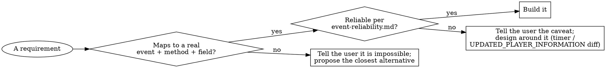

# Creating SquadJS Plugins

## Overview

A SquadJS plugin is an ES-module class — extending `BasePlugin` or `DiscordBasePlugin` — that
reacts to a **fixed set** of server events and acts through RCON. SquadJS gives you those
events, a small set of RCON/server methods, and a fixed set of player fields. Nothing else.

**Core principle:** map every requirement onto a real SquadJS event, method, and field
*before* writing code. If a requirement maps to nothing — or to something unreliable — say so
and propose the closest reliable alternative. **Never fabricate a capability.** A dead code
branch that reads a field which does not exist (death coordinates, player health) is worse
than telling the user the truth, because it ships as if it worked.

## When to use

- Creating or scaffolding a new SquadJS plugin, or adding a server-side feature via SquadJS.
- Answering "can SquadJS do / detect X?" — use the capability surface + hard limits below.
- Reviewing a plugin for the common traps (see Common Mistakes).

Not for: modifying the SquadJS core itself, or non-SquadJS Discord bots.

## Workflow

1. **Brainstorm intent first.** REQUIRED SUB-SKILL: `superpowers:brainstorming`. Pin down the
   concrete behaviours the admin wants, in plain language, before any mapping.
2. **Map each requirement → capability.** For every behaviour, find the event that triggers it
   and the method that performs it in `references/api-reference.md`. Write the mapping down.
3. **Feasibility gate.** Check each mapping against `references/event-reliability.md`. If a
   requirement maps to nothing, or to an unreliable signal, STOP and tell the user *before*
   coding. The hard-limits table below lists the usual culprits.
4. **Pick base class & connectors.** `DiscordBasePlugin` if it posts to Discord, else
   `BasePlugin`. Add the `sequelize` connector only if state must survive restarts.
5. **Scaffold from a template.** Copy the matching file from `templates/` — they already encode
   the correct lifecycle and avoid the traps below.
6. **Implement.** Bind every handler in the constructor; `mount()` and `unmount()` must be
   exactly symmetric; handlers must be idempotent (events burst and duplicate); read config
   from `this.options.*`.
7. **Verify + install.** `references/installation.md` covers the `config.json` block and
   live-server verification (load it, watch `verbose` output, exercise it in-game).

### Before you finish — mechanical self-checks (run these on your plugin file)

Do not rely on memory or on copied code — run each check; every one must pass:

- **`grep -n removeEventListener <file>` returns nothing.** It throws `TypeError` at runtime
  and leaks the listener; use `removeListener`/`off`. This is the single most common bug, and
  the bundled core plugins (`discord-teamkill.js`, `auto-tk-warn.js`, …) contain it — so if you
  modelled your code on a core/example plugin, you almost certainly copied it. Fix it.
- **Listener symmetry:** every `this.server.on(...)` in `mount()` has a matching
  `removeListener` in `unmount()`, and every `setInterval`/`setTimeout` has a matching
  `clearInterval`/`clearTimeout` in `unmount()`.
- **No invented API:** every event name you register, and every `rcon.*`/`server.*` call,
  appears in `references/api-reference.md`. If it's not there, it doesn't exist.

### The feasibility-gate decision (where it goes wrong)

## Hard limits — SquadJS CANNOT do these (verified against the core)

| Request | Reality |
|---|---|
| get a single reliable "player left" event covering **all** departures | `PLAYER_DISCONNECTED` fires for clean disconnects only — not kicks/bans (#287) — and can pass a `null` player (#289). Diff `server.players` on `UPDATED_PLAYER_INFORMATION` for complete departure detection. |
| "react when the round goes live / staging ends" | No such event. `NEW_GAME` fires when staging *begins* (~260 s before live). Approximate with a `setTimeout` from `NEW_GAME`. |
| player position / map coordinates / grid | No event or RCON command exposes player or death coordinates. The player object has no x/y/z. |
| player health / HP / stamina | Not exposed anywhere. |
| "which kit/role fired that shot" from the kill event | The `weapon` string is the damage *causer* blueprint and carries no kit information — most weapons are shared across kits. Read `attacker.role` (30 s poll, can lag a kit switch) or track `PLAYER_POSSESS`. A soldier blueprint appearing as `weapon` is the **victim's** kit, not the attacker's (`references/weapon-strings.md` §4). |
| reliable team data immediately after `NEW_GAME` | `teamID` is `null` transiently (~30 s) for many players right after `NEW_GAME`. |
| kick / change layer / end match / disband squad | No dedicated wrapper — use `rcon.execute('Admin…')`. Wrappers exist only for `broadcast`, `warn`, `ban`, `switchTeam`, `setFogOfWar`. |

## Quick reference

Most-used events: `CHAT_COMMAND:<name>`, `CHAT_MESSAGE`, `PLAYER_WOUNDED`, `PLAYER_DIED`,
`TEAMKILL`, `PLAYER_TEAM_CHANGE`, `NEW_GAME`, `ROUND_ENDED`, `UPDATED_PLAYER_INFORMATION`.
Act via `this.server.rcon.warn(anyID, msg)`, `.broadcast(msg)`, `.switchTeam(anyID)`,
`.execute(rawAdminCommand)`. Full catalog + every payload shape: `references/api-reference.md`.

Anything keyed on **which weapon** or **which kit/role** — killfeeds, weapon bans, per-role stats,
"warn the marksman", vehicle-kill vs infantry-kill: `references/weapon-strings.md` (blueprint-string
grammar, tested classifier, role parsing, observed catalogue). The one rule to carry in: the weapon
string never tells you the attacker's kit — `role` does.

Three non-obvious patterns (see `references/api-reference.md` §3, §4, §7):
- **Team by faction short name, not `teamID`.** No faction field exists; `teamID` 1/2 flips each
  round. Resolve a short name (`"USA"`) via the `role` classname prefix (`USA_Rifleman_01`) — a
  naming convention, not an API guarantee.
- **Configurable / aliased command lists**: loop and register `CHAT_COMMAND:${cmd}` per alias
  (normalize a string-or-array option to an array, bind once, mirror in `unmount`); match
  `CHAT_MESSAGE` yourself only when the trigger isn't a clean single `!word` (see §3).
- **Double-switch to unstick a bugged player** (§4): call `switchTeam` twice with a short delay —
  the player leaves and returns to their own team, re-spawning the pawn with no net side change.

## Common mistakes (every one observed in baseline testing)

| Mistake | Fix |
|---|---|
| `this.server.removeEventListener(...)` in `unmount` | **It does not exist** on the Node `EventEmitter` server — it throws `TypeError` and the listener leaks. Use `this.server.removeListener(...)` (or `.off(...)`). Many bundled/example plugins (including `activity-tracker`) use the broken form — do not copy it. |
| `.on(event, (data) => this.onFoo(data))` then `.removeListener(event, this.onFoo)` in `unmount` | `removeListener` matches by function **reference**, not name — the anonymous arrow registered in `mount` is a different function object than `this.onFoo`, so the call is a silent no-op and the listener leaks (no error thrown). Bind once in the constructor (`this.onFoo = this.onFoo.bind(this)`) and pass that same bound reference — never a fresh wrapper — to both `.on()` and `.removeListener()`. |
| Relying on `PLAYER_DISCONNECTED` as your sole departure trigger | It catches clean disconnects only (not kicks/bans) and can fire with a `null` player. Use it as a fast supplement; diff `server.players` on `UPDATED_PLAYER_INFORMATION` for complete detection. |
| `this.server.rcon.kick(...)` or other invented methods | Only `broadcast`/`setFogOfWar`/`warn`/`ban`/`switchTeam`/`get*`/`execute` exist. Kick = `execute('AdminKick "<id>" <reason>')`. |
| Reading invented payload fields (`data.location.x`, `health`) | They do not exist. Use only the fields listed in `api-reference.md`. Do not write dead branches for fields that "might" exist later. |
| `setInterval`/`setTimeout` not cleared in `unmount` | Store the handle and clear it in `unmount` alongside listener removal. |
| A `required: true` option whose config value equals its `default` | `BasePlugin` throws at load. Required options must be given a non-default value in config. |
| `"plugin"` name in config ≠ exported class name | They must match exactly; SquadJS loads plugins by class name. |
| Using `steamID` as the primary key | `eosID` is the primary id (always present); `steamID` is the fallback. |
| Handling `PLAYER_WOUNDED` **and** `TEAMKILL` in the same plugin | `TEAMKILL` is emitted *in addition to* `PLAYER_WOUNDED`, carrying the **same object** — so counters increment twice for a teamkill, and mutating `info` in one handler is visible in the other. Listen to one, and branch on `info.teamkill` (truthy test — it is `undefined`, not `false`, when a player could not be resolved). |
